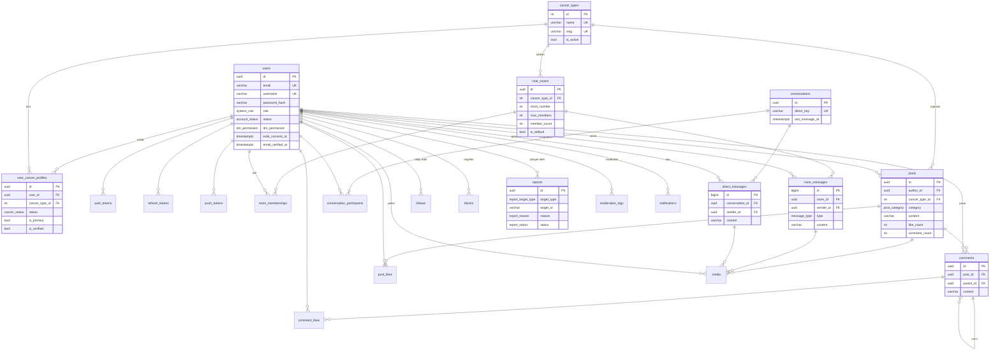

# OnkoBağ — Veri Modeli

**Veritabanı:** PostgreSQL · **Şema yönetimi:** Prisma ORM
**Kaynak:** [`backend/prisma/schema.prisma`](../backend/prisma/schema.prisma) · Ek kısıtlar: [`backend/prisma/sql/constraints.sql`](../backend/prisma/sql/constraints.sql)

## 1. Tasarım İlkeleri

| İlke | Uygulama |
|---|---|
| **Rol ayrımı** | Sistem yetkisi (`USER` / `MODERATOR` / `ADMIN`) ile hastalık durumu (`ACTIVE_TREATMENT` / `SURVIVOR`) ayrı tutulur. Bir moderatör aynı zamanda iyileşen olabilir. |
| **Çoklu hastalık profili** | Kullanıcı birden fazla kanser türüyle ilişkilendirilebilir (ör. bir türü atlatmış, başka bir türde tedavide). Ana profil `is_primary` ile işaretlenir. |
| **Ölçeklenebilir odalar** | Her kanser türünün başlangıçta tek bir varsayılan odası vardır. Oda `max_members` kapasitesine ulaştığında aynı tür altında yeni oda (`room_number` = 2, 3, …) açılır. |
| **Gizlilik (KVKK)** | Sağlık verisi özel nitelikli kişisel veridir: açık rıza zamanı (`kvkk_consent_at`) tutulur, gerçek ad zorunlu değildir (takma ad `username`), TC kimlik numarası **saklanmaz**. Şifre, doğrulama ve refresh tokenları yalnızca hash olarak saklanır. |
| **Soft delete** | İçerikler (`posts`, `comments`, mesajlar) `status` alanıyla gizlenir/silinir. Moderasyon geçmişi ve şikayet kanıtı korunur. |
| **Performans** | Mesaj tabloları `BIGINT` kimlik + `(oda, id DESC)` indeksiyle cursor tabanlı sayfalanır. Beğeni/yorum/üye sayıları denormalize sayaçlarda tutulur. |
| **Bütünlük** | Prisma'nın desteklemediği kurallar (kendini takip etme yasağı, tek ana profil, tek varsayılan oda, medyanın tek hedefe bağlanması vb.) SQL CHECK ve kısmi unique indekslerle sağlanır. |

## 2. Varlık-İlişki (ER) Diyagramı



## 3. Tablolar

### 3.1 Kullanıcı ve Kimlik Doğrulama

| Tablo | Açıklama | Önemli alanlar |
|---|---|---|
| `users` | Kullanıcı hesabı | `email` (küçük harf, benzersiz), `username` (takma ad), `role`, `status`, `dm_permission` (kim DM atabilir), `kvkk_consent_at`, `email_verified_at`, `suspended_until`, `deleted_at` |
| `auth_tokens` | E-posta doğrulama ve şifre sıfırlama tokenları | `type`, `token_hash`, `expires_at`, `used_at` (tek kullanımlık) |
| `refresh_tokens` | JWT refresh token oturumları (cihaz bazlı) | `token_hash`, `expires_at`, `revoked_at` |
| `push_tokens` | Push bildirimi cihaz tokenları | `token`, `platform` |

### 3.2 Kanser Türleri ve Hastalık Profili

| Tablo | Açıklama | Önemli alanlar |
|---|---|---|
| `cancer_types` | Kanser türü kataloğu (seed ile 24 tür) | `name`, `slug`, `sort_order`, `is_active` |
| `user_cancer_profiles` | Kullanıcı ↔ kanser türü ilişkisi ve rolü | `status` (aktif tedavi / iyileşen), `diagnosis_year`, `remission_year`, `is_primary`, `is_verified` (moderatör onaylı iyileşen rozeti) |

### 3.3 Genel Sohbet Odaları

| Tablo | Açıklama | Önemli alanlar |
|---|---|---|
| `chat_rooms` | Kanser türüne özgü canlı sohbet odası | `room_number`, `max_members`, `member_count`, `is_default` |
| `room_memberships` | Kullanıcının odaya üyeliği | `last_read_message_id` (okunmamış sayısı), `is_muted`, `silenced_until` (moderatör susturması) |
| `room_messages` | Oda mesajları | `type` (TEXT/IMAGE/SYSTEM), `content`, `reply_to_id`, `status` |

**Oda atama algoritması (backend):** Kullanıcı kanser profilini oluşturduğunda, o türün aktif odalarından `member_count < max_members` olan en küçük `room_number`'lı odaya eklenir. Boş kapasiteli oda yoksa `room_number = MAX + 1` ile yeni oda açılır. İşlem tek transaction içinde yapılır.

### 3.4 Birebir Özel Mesajlaşma

| Tablo | Açıklama | Önemli alanlar |
|---|---|---|
| `conversations` | İki kullanıcı arasındaki sohbet | `direct_key` = `"<küçük uuid>:<büyük uuid>"` → aynı çift için tek sohbet garantisi, `last_message_at` (liste sıralaması) |
| `conversation_participants` | Sohbetin iki tarafı | `last_read_message_id`, `is_muted`, `hidden_at` (listeden silme) |
| `direct_messages` | Özel mesajlar | `type`, `content`, `status` |

DM başlatma kuralı: Alıcının `dm_permission` ayarı ve iki yönlü `blocks` kaydı backend'de kontrol edilir.

### 3.5 Gönderiler ve Etkileşim

| Tablo | Açıklama | Önemli alanlar |
|---|---|---|
| `posts` | Topluluk gönderisi (bir kanser türüne ait) | `category` (soru, deneyim, tedavi, yan etkiler, motivasyon, günlük yaşam), `title`, `content`, `like_count`, `comment_count`, `status` |
| `comments` | Gönderi yorumları (tek seviye yanıt) | `parent_id`, `like_count`, `status` |
| `post_likes`, `comment_likes` | Beğeniler | Birleşik birincil anahtar → aynı kullanıcı iki kez beğenemez |
| `media` | Görsel meta verisi (dosya nesne depolamada) | `storage_key`, `url`, `mime_type`, `size_bytes`; `post_id` / `room_message_id` / `direct_message_id`'den **en fazla biri** dolu |

### 3.6 Sosyal İlişkiler, Şikayet ve Moderasyon

| Tablo | Açıklama | Önemli alanlar |
|---|---|---|
| `follows` | Takip ilişkisi | `follower_id`, `following_id` (kendini takip edemez) |
| `blocks` | Engelleme | `blocker_id`, `blocked_id` |
| `reports` | İçerik/kullanıcı şikayeti (polimorfik) | `target_type`, `target_id`, `reason` (spam, taciz, **yanlış tıbbi bilgi**, **kendine zarar riski** …), `status`, `reviewed_by_id` |
| `moderation_logs` | Moderatör işlemlerinin denetim kaydı | `action`, `target_*`, `report_id`, `metadata` (JSON) |
| `notifications` | Uygulama içi bildirimler | `type`, `actor_id`, `entity_id`, `read_at` |

## 4. Silme Davranışları

| İlişki | Davranış |
|---|---|
| Kullanıcı silinirse | Profil, token, üyelik, gönderi, yorum, beğeni, takip, engel → `CASCADE`. Mesajlarda `sender_id` → `NULL` (konuşmanın karşı tarafı için geçmiş korunur). Şikayet/moderasyon kayıtlarında ilgili kullanıcı alanı → `NULL`. |
| Kanser türü | Bağlı profil/oda/gönderi varken silinemez (`RESTRICT`); bunun yerine `is_active = false` yapılır. |
| Gönderi / oda / sohbet silinirse | Altındaki yorum, beğeni, mesaj ve medya kayıtları `CASCADE`. |

> Not: Uygulamada kullanıcı silme işlemi önce **soft delete** (`status = DELETED`, `deleted_at`) olarak yapılır; KVKK kapsamındaki kalıcı silme talepleri ayrı bir iş akışıyla fiziksel silmeye dönüştürülür.

## 5. Kurulum (backend iskeleti oluşturulduktan sonra)

```bash
cd backend
npx prisma migrate dev --create-only --name init   # migration dosyasını üret
# prisma/sql/constraints.sql içeriğini üretilen migration.sql sonuna ekle
npx prisma migrate dev                              # migration'ı uygula
npx prisma db seed                                  # kanser türleri + varsayılan odalar
```
